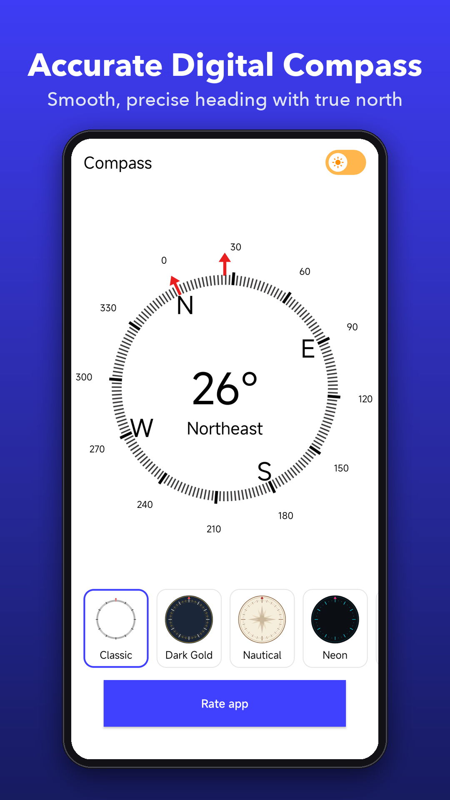
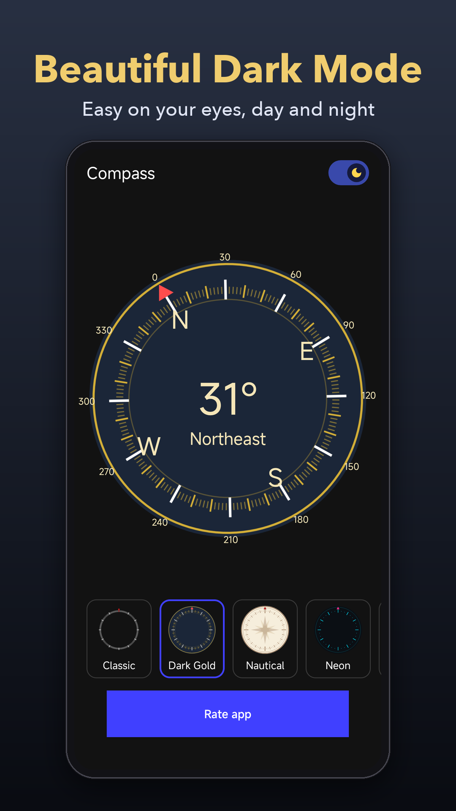
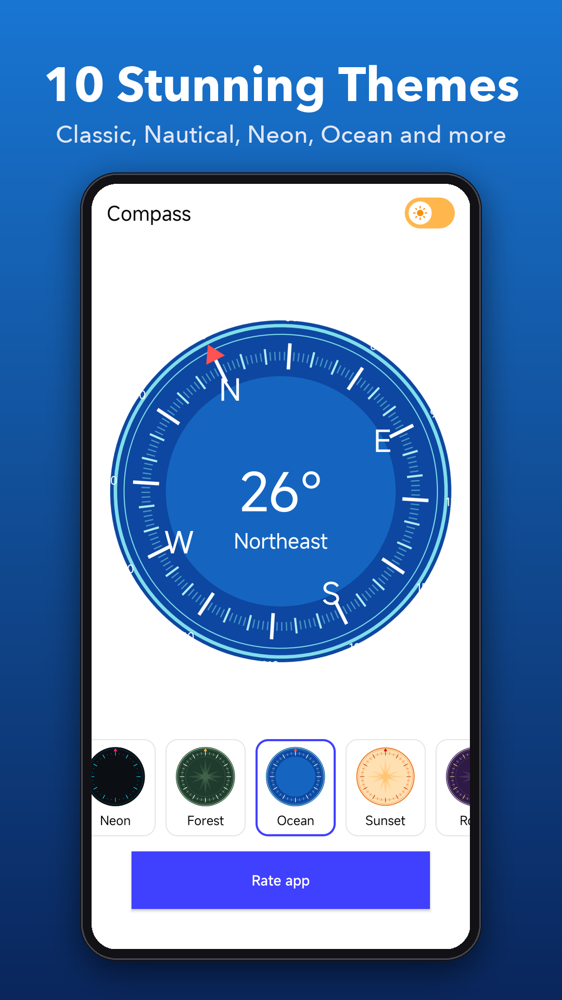
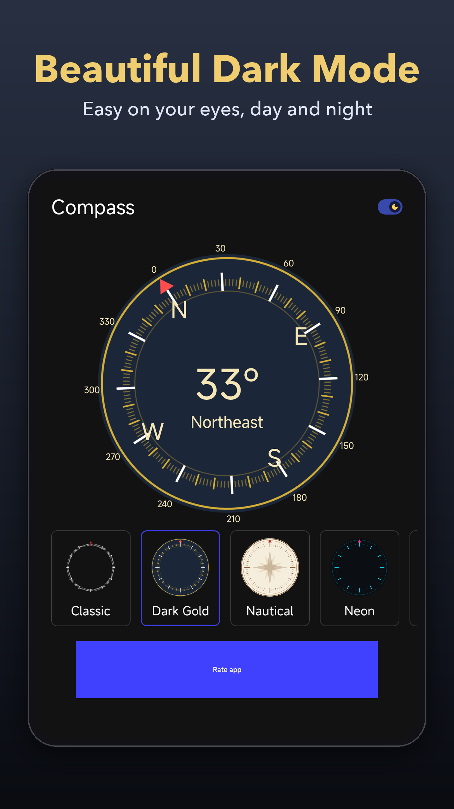
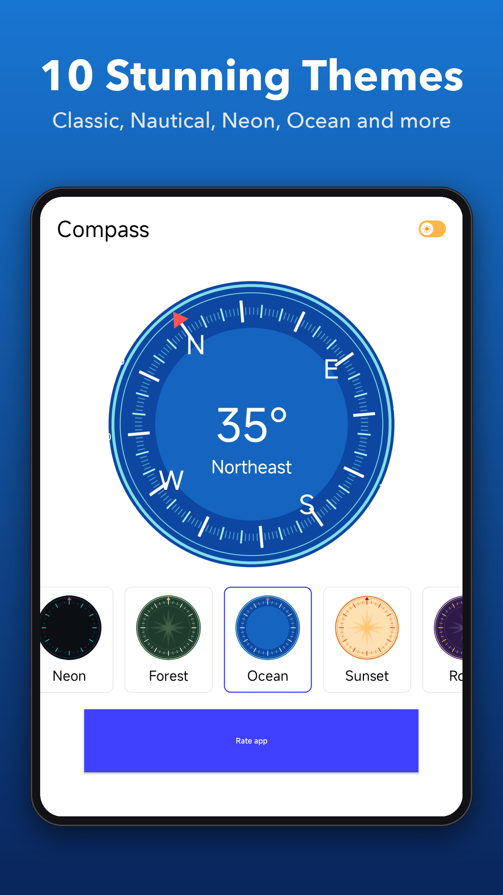
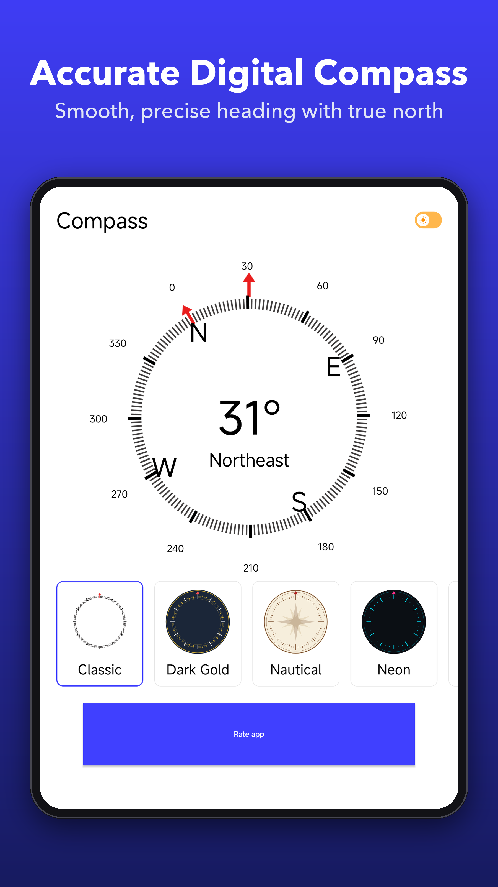
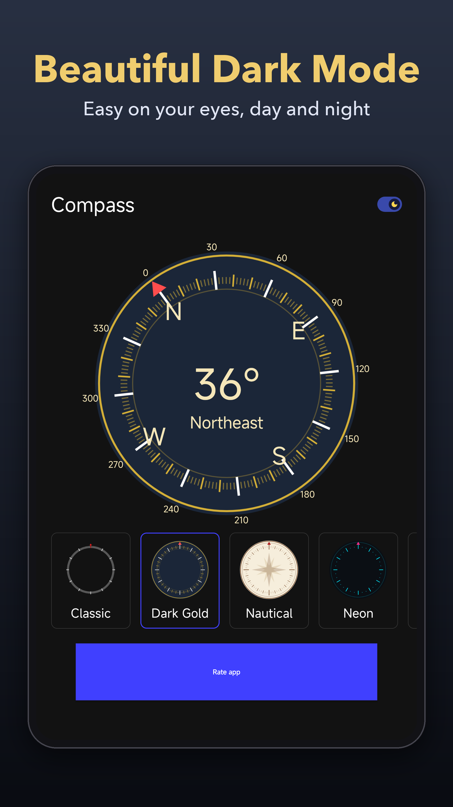
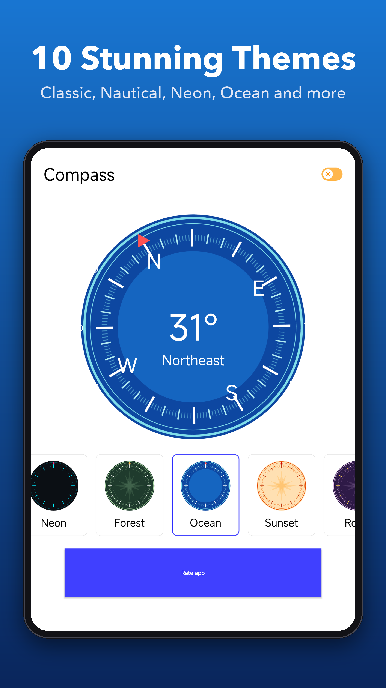

# Compass – Google Play Store Listing

App: **Compass** (`com.naohstudio.compassfree`)

---

## 🇬🇧 English (en-US)

### Short description (max 80 chars)

```
Accurate compass with true north, dark mode and 10 beautiful compass themes
```

### Full description (max 4000 chars)

```
Compass is a simple, accurate and beautiful digital compass for your Android phone and tablet. Open the app and instantly see which way you are facing – no setup, no sign-in, no clutter.

🧭 ACCURATE HEADING
• Smooth, stable needle powered by your phone's rotation sensor
• Shows the exact heading in degrees and the direction name (North, Northeast, East…)
• Works whether your phone lies flat or is held upright – the heading follows the direction the back of your phone points
• Smart filtering keeps the dial steady, no jitter and no sudden spins at 0°/360°

🌍 TRUE NORTH, NO LOCATION PERMISSION
• Automatically corrects magnetic declination to point to true (geographic) north
• Uses only your approximate region – the app never asks for GPS or location permission
• Once calculated, the correction is saved so the compass keeps working offline

🎨 10 STUNNING COMPASS THEMES
Classic, Dark Gold, Nautical, Neon, Forest, Ocean, Sunset, Royal, Military and Ice. Pick the style you love – your choice is remembered.

🌙 LIGHT & DARK MODE
Switch between light and dark mode with one tap, or simply follow your device's system setting. Easy on your eyes, day and night.

📳 HAPTIC FEEDBACK
Feel a gentle tick as you turn, so you can find your direction without staring at the screen.

🎯 CALIBRATION REMINDER
If the magnetic sensor becomes inaccurate, the app reminds you to move your phone in a figure 8 to recalibrate.

📱 PHONE & TABLET READY
A clean, large dial designed to look great on phones and tablets.

🌐 MULTILINGUAL
Available in more than 20 languages, including English, Vietnamese, Spanish, French, German, Japanese, Korean, Chinese, Arabic, Hindi, Russian, Portuguese and more.

PERFECT FOR
• Hiking, camping, trekking and outdoor adventures
• Travel and finding your way in a new city
• Finding Qibla direction or feng shui orientation
• Boating, fishing and other outdoor activities
• Students learning about directions and geography

TIPS FOR BEST ACCURACY
• Keep your phone away from magnets, metal objects and electronic devices
• Remove magnetic phone cases or mounts
• If the reading looks wrong, move your phone in a figure 8 to calibrate

Note: Your device must have a magnetic sensor (magnetometer) for the compass to work.

Download Compass now and never lose your direction again! If you enjoy the app, please leave us a 5-star rating ⭐⭐⭐⭐⭐
```

### Screenshot captions (used in images)

| # | Title | Subtitle |
|---|-------|----------|
| 1 | Accurate Digital Compass | Smooth, precise heading with true north |
| 2 | Beautiful Dark Mode | Easy on your eyes, day and night |
| 3 | 10 Stunning Themes | Classic, Nautical, Neon, Ocean and more |

---

## 🇻🇳 Tiếng Việt (vi)

### Mô tả ngắn (tối đa 80 ký tự)

```
La bàn chính xác, chỉ hướng Bắc thật, chế độ tối và 10 giao diện đẹp mắt
```

### Mô tả đầy đủ (tối đa 4000 ký tự)

```
Compass là ứng dụng la bàn kỹ thuật số đơn giản, chính xác và đẹp mắt cho điện thoại và máy tính bảng Android. Chỉ cần mở ứng dụng là bạn biết ngay mình đang hướng về phía nào – không cần cài đặt, không cần đăng nhập.

🧭 CHỈ HƯỚNG CHÍNH XÁC
• Kim la bàn mượt mà, ổn định nhờ cảm biến xoay của điện thoại
• Hiển thị góc chính xác theo độ và tên hướng (Bắc, Đông Bắc, Đông…)
• Hoạt động cả khi đặt điện thoại nằm ngang hay cầm dựng đứng – hướng được tính theo phía mặt lưng điện thoại
• Bộ lọc thông minh giúp mặt la bàn không bị rung, không bị xoay vòng khi qua mốc 0°/360°

🌍 HƯỚNG BẮC THẬT, KHÔNG CẦN QUYỀN VỊ TRÍ
• Tự động hiệu chỉnh độ lệch từ để chỉ đúng hướng Bắc thật (Bắc địa lý)
• Chỉ dùng khu vực gần đúng – ứng dụng không bao giờ xin quyền GPS hay vị trí
• Sau khi tính xong, giá trị hiệu chỉnh được lưu lại để la bàn vẫn hoạt động khi không có mạng

🎨 10 GIAO DIỆN LA BÀN ĐẸP MẮT
Classic, Dark Gold, Nautical, Neon, Forest, Ocean, Sunset, Royal, Military và Ice. Chọn phong cách bạn yêu thích – ứng dụng sẽ ghi nhớ lựa chọn của bạn.

🌙 CHẾ ĐỘ SÁNG & TỐI
Chuyển đổi giữa chế độ sáng và tối chỉ với một chạm, hoặc tự động theo cài đặt của máy. Dễ chịu cho mắt cả ngày lẫn đêm.

📳 PHẢN HỒI RUNG
Cảm nhận rung nhẹ khi xoay, giúp bạn tìm hướng mà không cần nhìn chằm chằm vào màn hình.

🎯 NHẮC HIỆU CHỈNH
Khi cảm biến từ kém chính xác, ứng dụng sẽ nhắc bạn xoay điện thoại theo hình số 8 để hiệu chỉnh lại.

📱 TỐI ƯU CHO ĐIỆN THOẠI & MÁY TÍNH BẢNG
Mặt la bàn lớn, rõ ràng, hiển thị đẹp trên cả điện thoại và máy tính bảng.

🌐 ĐA NGÔN NGỮ
Hỗ trợ hơn 20 ngôn ngữ, gồm tiếng Việt, tiếng Anh, Tây Ban Nha, Pháp, Đức, Nhật, Hàn, Trung, Ả Rập, Hindi, Nga, Bồ Đào Nha và nhiều ngôn ngữ khác.

PHÙ HỢP CHO
• Leo núi, cắm trại, đi phượt và các chuyến dã ngoại
• Du lịch, tìm đường ở thành phố mới
• Xem hướng nhà, hướng phong thủy, hướng Qibla
• Đi thuyền, câu cá và các hoạt động ngoài trời
• Học sinh tìm hiểu về phương hướng và địa lý

MẸO ĐỂ ĐO CHÍNH XÁC NHẤT
• Để điện thoại tránh xa nam châm, vật kim loại và thiết bị điện tử
• Tháo ốp lưng hoặc giá đỡ có nam châm
• Nếu kết quả có vẻ sai, hãy xoay điện thoại theo hình số 8 để hiệu chỉnh

Lưu ý: Thiết bị cần có cảm biến từ trường (magnetometer) để la bàn hoạt động.

Tải Compass ngay để không bao giờ lạc hướng! Nếu bạn thấy ứng dụng hữu ích, hãy đánh giá 5 sao cho chúng tôi nhé ⭐⭐⭐⭐⭐
```

---

## Hình ảnh ASO

Tất cả ảnh tỉ lệ 9:16, định dạng PNG, đã ẩn quảng cáo, đã cắt status bar và thanh điều hướng.

| Loại | Kích thước | File |
|------|-----------|------|
| Phone | 1080 × 1920 | `phone/phone_1.png`, `phone/phone_2.png`, `phone/phone_3.png` |
| Tablet 7 inch | 1440 × 2560 | `tablet-7inch/tablet-7inch_1.png`, `tablet-7inch/tablet-7inch_2.png`, `tablet-7inch/tablet-7inch_3.png` |
| Tablet 10 inch | 1800 × 3200 | `tablet-10inch/tablet-10inch_1.png`, `tablet-10inch/tablet-10inch_2.png`, `tablet-10inch/tablet-10inch_3.png` |

Nội dung từng ảnh:
1. **Accurate Digital Compass** – chế độ sáng, giao diện Classic
2. **Beautiful Dark Mode** – chế độ tối, giao diện Dark Gold
3. **10 Stunning Themes** – chế độ sáng, giao diện Ocean

### Phone
  

### Tablet 7 inch
  

### Tablet 10 inch
  
